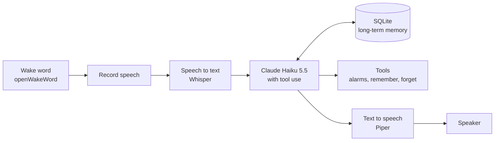

# Claude Raspberry Pi Assistant

A voice personal assistant for the Raspberry Pi, built on the Claude API. Say its name, ask a question, and it answers out loud. It can also set alarms and remember things about you between sessions.

Think Alexa, but built from scratch, so every piece is something I wrote and understand.

> **Status:** In progress. Right now it's a text chat in the terminal that keeps track of the conversation and can set alarms. Milestone 1 (chat) is done, and Milestone 2 (alarms) has a working prototype. See [Roadmap](#roadmap).

---

## What it will do

- **Answer questions out loud.** You speak, it transcribes, Claude responds, and it speaks the reply.
- **Set alarms.** "Wake me in 2 minutes" schedules a sound to play on the device.
- **Remember you.** It saves facts you tell it to a local database and still knows them after a restart.
- **Listen for its name.** A wake word starts it listening, so there's no button to press.
- **Run on its own.** The finished build starts on boot on a Raspberry Pi with no laptop attached.

## How it works

This is the full design. The parts marked "planned" in the [tech stack](#tech-stack) aren't built yet.



1. **openWakeWord** listens for the assistant's name.
2. **Whisper** turns what you said into text.
3. **Claude Haiku 5.5** decides how to respond. It has the conversation history plus any saved facts in its system prompt, and it can call tools.
4. **Tools** do the real-world actions: setting an alarm, saving a fact, deleting a fact.
5. **Piper** turns Claude's reply into speech.

## Tech stack

| Part | Tool | Status |
|---|---|---|
| Language | Python | In use |
| AI model | Claude Haiku 5.5 via the Anthropic Python SDK (tool use) | In use |
| Config | python-dotenv (loads the API key from `.env`) | In use |
| Long-term memory | SQLite | Planned (Milestone 3) |
| Speech to text | Whisper | Planned (Milestone 4) |
| Text to speech | Piper | Planned (Milestone 4) |
| Wake word | openWakeWord | Planned (Milestone 5) |
| Hardware | Raspberry Pi 4 or 5, USB microphone, speaker | Planned (Milestone 6) |

## Design decisions

- **Alarms play locally.** An alarm runs on a timer on the device and plays a sound file stored there, so it still goes off if Wi-Fi drops.
- **Claude decides when to use a tool.** Alarms are a tool (`set_alarm_tool`) that Claude calls with a number of seconds. Memory will work the same way, through `remember` and `forget` tools, with saved facts loaded into the system prompt at startup.
- **Secrets stay out of git.** The API key lives in `.env`, which is listed in `.gitignore` and never committed.
- **Laptop first, Pi last.** Everything is built and tested on a laptop, then moved to the Pi once it works.

## Project structure

```
pi-assistant/
├── main.py            # chat loop, Claude API call, alarm tool
├── requirements.txt   # Python dependencies
└── .gitignore         # keeps .env and .venv out of git
```

## Getting started

### Requirements

- Python 3
- An Anthropic API key ([console.anthropic.com](https://console.anthropic.com))
- macOS for now: the alarm sound plays with macOS's built-in `afplay` command

### Setup

```bash
git clone https://github.com/rahhhbert/claude-raspberry-pi-assistant.git
cd claude-raspberry-pi-assistant/pi-assistant

python3 -m venv .venv
source .venv/bin/activate

pip install -r requirements.txt
```

Create a `.env` file inside `pi-assistant/`:

```
claude_api_key=your-key-here
```

### Run

```bash
python main.py
```

Type at the `Prompt:` line to chat. Try "set an alarm for 10 seconds." Type `exit` to quit.

## Roadmap

Each milestone has a concrete test for when it's done.

- [x] **1. Chat:** remembers what I said 3 messages ago
- [ ] **2. Tools:** "wake me in 2 minutes" plays a sound 2 minutes later *(prototype working)*
- [ ] **3. Memory:** still knows a fact after I restart the program
- [ ] **4. Voice:** I speak, it answers out loud
- [ ] **5. Wake word:** saying its name starts it listening
- [ ] **6. Pi:** runs on boot with no laptop

### Ideas for later

- Turn smart lights on and off

## Why I built this

I wanted to learn how a voice assistant actually works end to end: speech recognition, an LLM that can take actions through tools, persistent memory, and getting it all running on small hardware. Building it one milestone at a time keeps each step small enough to understand before moving on.

## Author

**Robertus Nugroho**
[GitHub](https://github.com/rahhhbert) · [LinkedIn](https://www.linkedin.com/in/robertus-nugroho)
